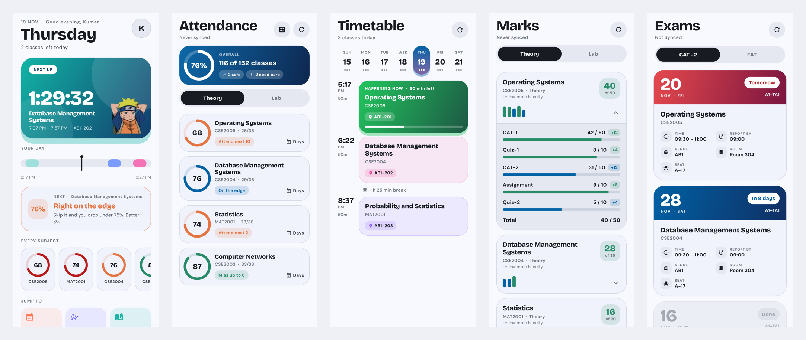
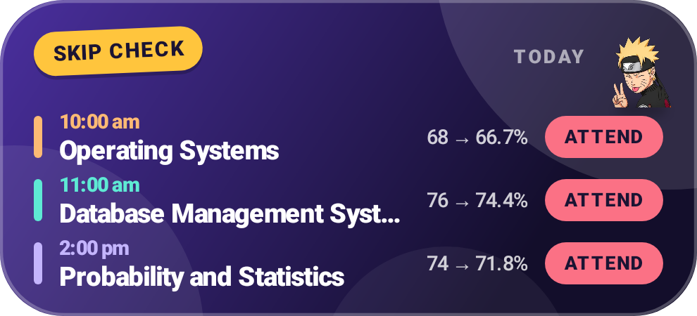
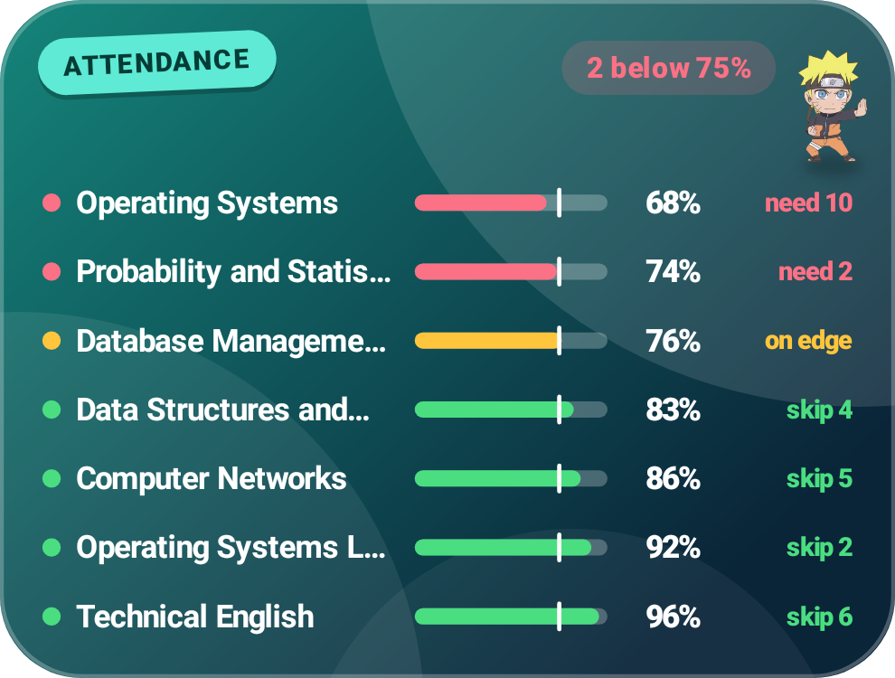
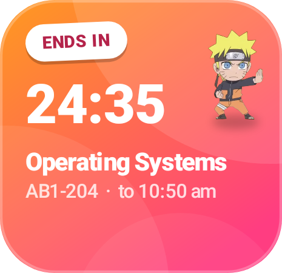
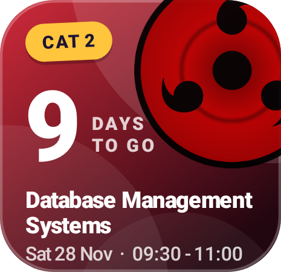

<p align="center">
  
</p>

<p align="center">
  <a href="https://flutter.dev"></a>
  <a href="https://www.rust-lang.org"></a>
  <a href="https://riverpod.dev"></a>
  
  <a href="LICENSE"></a>
</p>

<h3 align="center">VITAP Nexus is a fast, offline-first mobile client for VTOP, the VIT-AP student portal.<br>Your timetable, attendance and marks open instantly, and your home screen shows them without opening the app.</h3>

> **Unofficial project.** VITAP Nexus is a student-built app. It is not affiliated with or endorsed by VIT-AP University or the VTOP team. You log in with your own VTOP account, and you use the app at your own risk.

---

## ✨ Why Nexus?

VTOP is built for a desktop browser. On a phone it is slow, times out, and makes you dig through tables to answer simple questions like *"do I have class right now?"* or *"can I skip this one?"*.

| | |
| :--- | :--- |
| ⚡ **Opens instantly** | Cached data renders immediately, then refreshes in the background (stale-while-revalidate). |
| 🦀 **No server in the middle** | A native Rust engine logs in to VTOP and parses the pages **on your phone**. Nothing is proxied through a third-party backend. |
| 📴 **Works offline** | Timetable, attendance, marks and exam schedule stay available when the campus Wi-Fi does not. |
| 🧮 **Answers, not tables** | A home screen that tells you what is happening now, whether you can skip the next class, and what your CGPA could become. |
| 📱 **Home-screen widgets** | Five widgets that stay live without opening the app, with a character and colours you choose. |
| 🎨 **Your look** | Character-based colours, light / dark / AMOLED, and motion throughout. |

---

## 📸 The app

<p align="center"></p>
<p align="center"></p>

<sub>All screenshots are rendered from the real app code with sample data, not real student records.</sub>

- **Today:** the home screen is built around the moment. A live card counts down to the end of the current class or the start of the next one, and changes colour and mood with your day. Below it: a strip of your day, a plain "safe to skip / do not skip" verdict for the next class, a ring for every subject, and shortcuts to everything else.
- **Attendance:** one overall ring, then every subject with its own ring and a verdict like *Miss up to 6* or *Attend next 10*. Day-wise logs and the calculator are one tap away.
- **Timetable:** a week strip with a sliding highlight and a timeline of the day. The class happening now becomes a bright card with a countdown.
- **Marks:** a score tile and one bar per assessment, opening into the full breakdown.
- **Exams:** every exam as a ticket with a countdown, time, venue, room and seat.

<p align="center"></p>

- **Journey and what-if:** your CGPA across semesters, the biggest jump, your strongest area, and a "try different grades" mode that shows what a change would do to your CGPA. Export it as a PDF or a picture.
- **Your colours:** pick widget colours from presets or from your character's picture. Widgets also have an optional glass mode.
- **Your character:** keep the bundled artwork, use any picture from your gallery or an image link, or turn it off. It appears on the home screen and on every widget.

---

## 📱 Home-screen widgets---

## 📱 Home-screen widgets

Nexus ships five Android widgets, drawn from scratch so they look the same on every launcher. Each subject keeps one colour across all of them, and the glow follows your app theme.

<table>
  <tr>
    <td width="50%" valign="top">
      <b>🗓 Day timeline</b> (4×2)<br>
      The current class, what is next, and your whole day as a live strip with a "now" marker. The character reacts: fighting in class, running when you are late.<br><br>
      
    </td>
    <td width="50%" valign="top">
      <b>📊 Attendance</b> (4×2)<br>
      One ring per subject, with <i>skip 4</i> / <i>need 10</i> underneath. Theory and lab are tracked separately.<br><br>
      
    </td>
  </tr>
  <tr>
    <td valign="top">
      <b>🤔 Skip check</b> (4×2)<br>
      For each upcoming class: what your attendance becomes if you skip it, and a verdict.<br><br>
      
    </td>
    <td valign="top">
      <b>📋 Attendance list</b> (resize taller)<br>
      Stretch the attendance widget and it becomes a full per-subject list with progress bars.<br><br>
      
    </td>
  </tr>
  <tr>
    <td valign="top">
      <b>⏱ Next class</b> (2×2)<br>
      A live countdown that ticks every second, to the start or end of the class.<br><br>
      
    </td>
    <td valign="top">
      <b>📅 Exam countdown</b> (2×2, resizable)<br>
      Days to the next exam. Stretch it and it lists every upcoming exam with date, time, session, venue, room and seat.<br><br>
      
      
    </td>
  </tr>
</table>

**Glass widgets:** turn on glass and the cards become see-through with a glossy sheen, so your wallpaper shows behind them. Android does not let widgets blur what is behind them, so this is clear tinted glass rather than frosted glass.

<p align="center"></p>

<sub>Images above are rendered from the real widget code with sample data.</sub>

**How they stay current:** the app saves a small snapshot of your timetable, attendance and exams whenever it syncs. The widgets work out "now" and "next" from the clock, and refresh themselves at each class start and end and at midnight, even if the app is closed. They never log in to VTOP on their own, so they show your last synced data.

---

## 🚀 Features

**Home and insights**
- **Today screen:** live now / next card, day strip, skip verdict, every-subject rings.
- **Journey and what-if:** semester-by-semester CGPA, biggest jump, strongest area, and a mode to try different grades. PDF and picture export.
- **Widget character:** bundled artwork, your own picture from the gallery or a link, or none. Widget and app colours follow it if you want.
- **Glass widgets:** optional see-through widgets that show your wallpaper behind them.

**Academics**
- **Attendance:** per-course percentages with 75% and 85% thresholds, a bunk calculator (how many you can miss, or must attend), day-wise session logs, and capstone attendance.
- **Timetable:** weekly view with a live current-class indicator and progress.
- **Exam schedule:** exam tickets with a countdown, slot, venue, room and seat.
- **Marks and grades:** component-wise marks, grade view, grade history, and a CGPA calculator.
- **Courses:** syllabus, lecture material and course details.
- **Digital assignments:** view assignments and due dates.
- **Academic calendar, faculty directory, and mentor details.**

**Campus life**
- **Hostel outings:** apply for general and weekend outings, track status, and generate a gate-pass PDF.
- **Biometric attendance records.**
- **Payments:** pending fees and receipts.

**The app itself**
- **Command palette:** jump to any screen by typing.
- **Themes:** 7 seed colours, light / dark / AMOLED, and a privacy mode that hides CGPA and credits.
- **App lock:** biometric unlock and a fallback PIN.
- **OTP handling:** if VTOP asks for an email OTP mid-session, Nexus asks for it in place and carries on.
- **Diagnostics screen** for debugging sync problems.

---

## 🏗️ Architecture

```
┌──────────────────────────────────────────────────────────────┐
│                       Flutter app (Dart)                     │
│   Screens · Riverpod providers · Stale-while-revalidate cache│
│   Secure + local storage · Theme system · Command palette    │
└───────────────┬──────────────────────────────┬───────────────┘
                │ flutter_rust_bridge          │ SharedPreferences snapshot
                ▼                              ▼
┌───────────────────────────────┐   ┌─────────────────────────────┐
│   lib_vtop (Rust, on-device)  │   │  Android home-screen widgets │
│   Login · captcha · session   │   │  Kotlin + Canvas rendering   │
│   HTML parsing → JSON         │   │  Alarm-driven refresh        │
└───────────────┬───────────────┘   └─────────────────────────────┘
                │ HTTPS
                ▼
        VTOP (VIT-AP student portal)
```

- **Rust engine:** logs in (including captcha and OTP), fetches pages, and parses them into JSON. It runs natively, so parsing large tables is fast and nothing goes through a middleman server.
- **Offline-first cache:** every feature has its own freshness window (for example 15 minutes for attendance, 8 hours for the timetable). The UI always shows what it has first and refreshes after.
- **Single-flight login:** many screens asking for data at once share one VTOP login, so you do not trigger duplicate logins or OTP emails.
- **Widgets:** the Flutter app writes a compact JSON snapshot; Kotlin draws each widget to a bitmap with `Canvas`. A JVM test renders every widget to PNG, which is how the pictures in this README were made.

---

## 🛠️ Tech stack

| Layer | Technology |
| :--- | :--- |
| App | Flutter, Dart 3, Riverpod, Dio, Google Fonts (Bricolage Grotesque + DM Sans), flutter_animate, Lottie |
| Native engine | Rust ([`lib_vtop`](#-credits)), `reqwest`, `flutter_rust_bridge` 2.12 |
| Storage | `flutter_secure_storage`, `shared_preferences` |
| Documents | `pdf`, `printing`, `share_plus`, `open_filex` |
| Widgets | Kotlin, Android `AppWidgetProvider`, `Canvas`, Robolectric (preview renders) |

---

## 📁 Repository layout

```
.
├── app/                    # The Flutter app (this is the project)
│   ├── lib/                #   Dart source: screens, providers, services, theme
│   ├── rust/               #   lib_vtop, the on-device VTOP engine (Rust)
│   ├── rust_builder/       #   Flutter plugin glue that builds the Rust crate
│   ├── android/            #   Android host app, including the home-screen widgets
│   └── assets/             #   Images, Lottie animations, bundled data
├── docs/                   # README images
├── src/, api/,             # Legacy FastAPI gateway from the first version of Nexus.
│   vitap_vtop_client/      # The current app does not need it.
└── LICENSE
```

---

## ⚙️ Getting started

**You will need:** Flutter (Dart `^3.12.2`), a Rust toolchain via [rustup](https://rustup.rs), and the Android SDK with NDK `28.2.13676358`. The Rust library is built automatically as part of the Android build.

```bash
git clone https://github.com/Gnanesh-2007/Vitap_nexus.git
cd Vitap_nexus/app

flutter pub get
flutter run                      # on a connected device or emulator
```

**Build a small release APK** (arm64 covers almost every phone made in the last several years):

```bash
flutter build apk --release --split-per-abi --target-platform android-arm64
# -> build/app/outputs/flutter-apk/app-arm64-v8a-release.apk  (about 37 MB)
```

**Using the widgets:** install the app, log in once and let it sync, then long-press your home screen, choose **Widgets**, and pick **VITAP Nexus**.

**Re-render the widget previews** (no phone needed):

```bash
cd app/android
./gradlew :app:testDebugUnitTest --tests "*WidgetRenderTest*"
# PNGs land in app/build/widget_previews
```

---

## 🔒 Privacy and security

- **Direct to VTOP.** The app talks to VTOP from your phone. There is no Nexus server, no analytics, and no account of ours that holds your data.
- **Local storage.** Your credentials and cached data are stored on the device only, and credentials are sent only to VTOP when logging in.
- **Privacy mode and app lock.** Hide CGPA and credits on screen, and require biometrics or a PIN to open the app.
- **Known limitation.** The saved password is written to `flutter_secure_storage` (Android Keystore) and also to plain `SharedPreferences` as a fallback. Removing the plain copy is on the [roadmap](#-roadmap).

---

## 🗺️ Roadmap

- [ ] Store the password only in secure storage (remove the plain fallback copy)
- [x] Real app screenshots in this README
- [ ] iOS home-screen widgets (SwiftUI)
- [ ] Leave planner: "what happens to my attendance if I am away 21 to 24 Nov?"
- [ ] End-of-semester summary cards

---

## 🙏 Credits

- **[`lib_vtop`](app/rust)**, the Rust VTOP engine, comes from [Udhay-Adithya/vitap_student_app](https://github.com/Udhay-Adithya/vitap_student_app) by the VIT-AP student community, licensed under **Apache-2.0** (see [`app/rust/LICENSE`](app/rust/LICENSE)). Nexus builds on that work.
- The app design (home screen, navigation, screens, widgets) is original to this project. Only the VTOP engine is reused.
- The bundled Naruto artwork belongs to its creators and is used here for personal, non-commercial fun. If you fork this, swap it for your own or choose "None" in Profile, Appearance, Widget character.

## 📄 License

The Nexus app code is released under the **MIT License**, see [LICENSE](LICENSE). The bundled `lib_vtop` crate keeps its own Apache-2.0 license.
