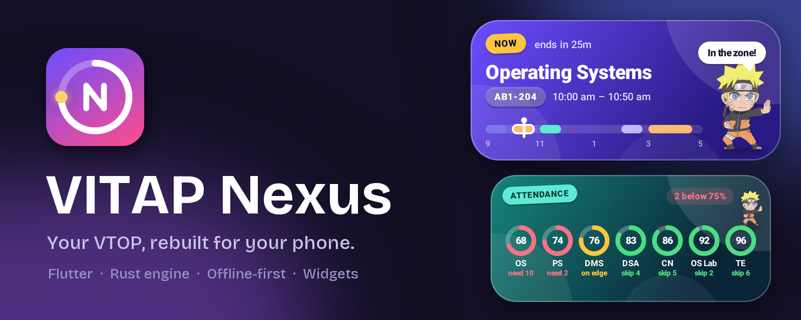
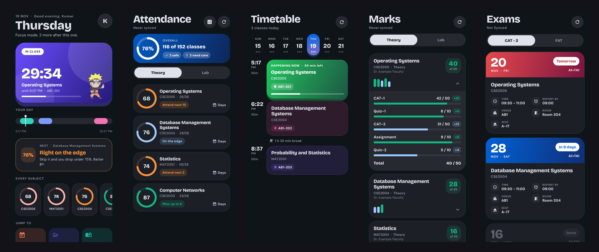
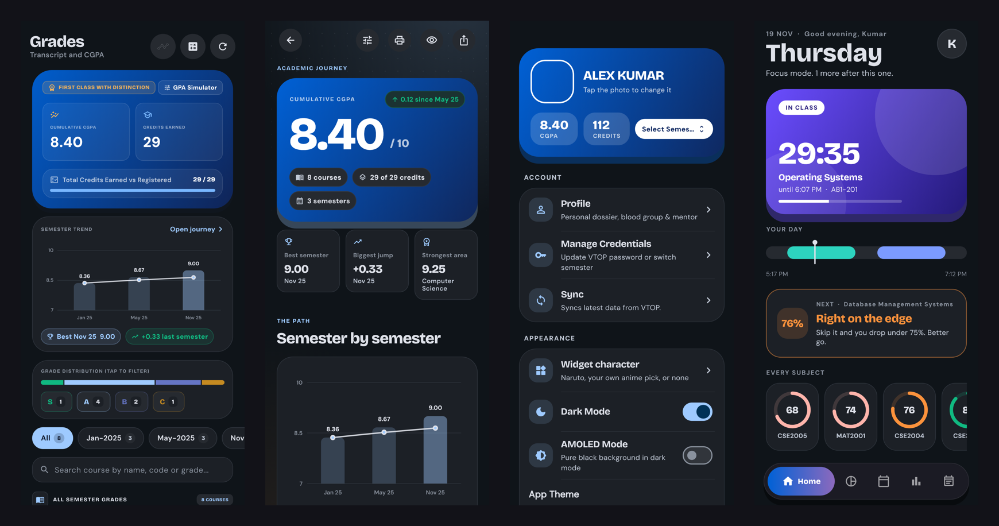
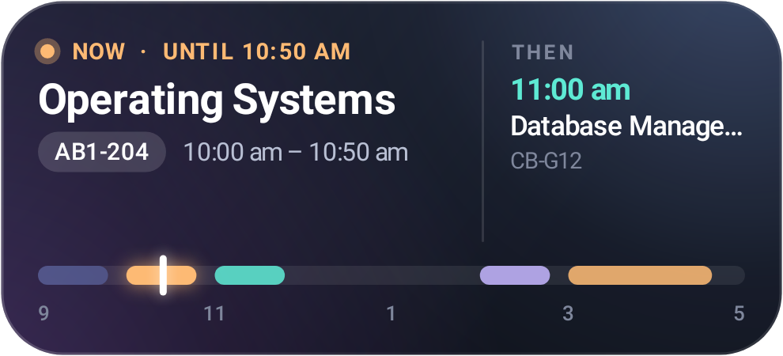
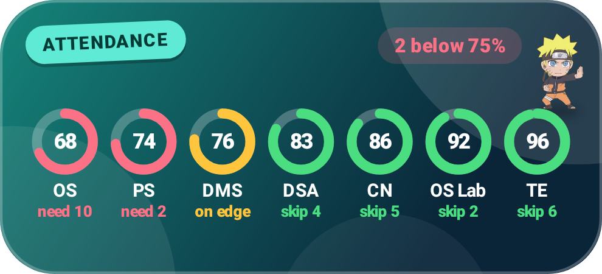
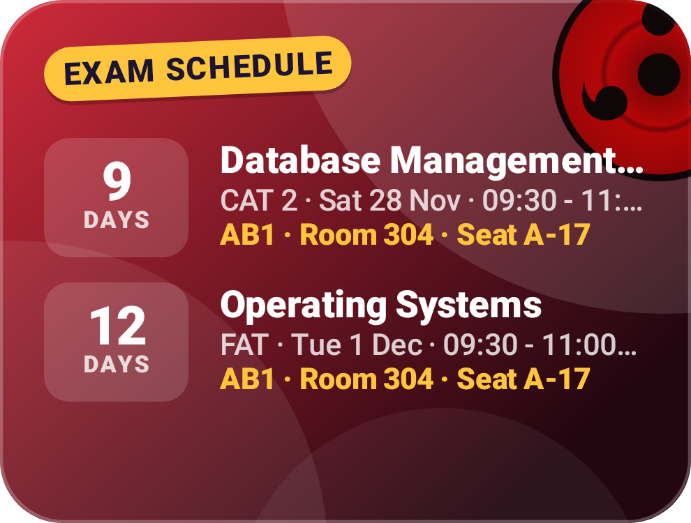
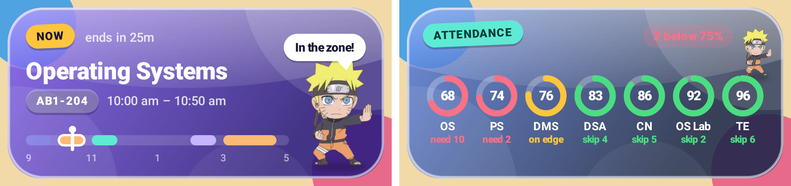

<p align="center">
  
</p>

<p align="center">
  <a href="https://flutter.dev"></a>
  <a href="https://www.rust-lang.org"></a>
  <a href="https://riverpod.dev"></a>
  
  <a href="LICENSE"></a>
</p>

# VITAP Nexus

VITAP Nexus is an offline-first Android client for VTOP, the VIT-AP University student portal. It presents your timetable, attendance, marks and exam schedule in a form designed for a phone, and keeps them visible on the home screen through widgets.

> **Unofficial project.** VITAP Nexus is a student-built application. It is not affiliated with, or endorsed by, VIT-AP University or the VTOP team. You sign in with your own VTOP account and use the app at your own risk.

## Contents

- [Overview](#overview)
- [Screenshots](#screenshots)
- [Home-screen widgets](#home-screen-widgets)
- [Features](#features)
- [Architecture](#architecture)
- [Technology](#technology)
- [Repository layout](#repository-layout)
- [Getting started](#getting-started)
- [Privacy and security](#privacy-and-security)
- [Roadmap](#roadmap)
- [Acknowledgements](#acknowledgements)
- [License](#license)

## Overview

VTOP is designed for a desktop browser. On a phone it is slow, sessions time out, and simple questions such as "do I have class right now?" or "can I skip this one?" require reading through tables.

Nexus addresses this in four ways:

| Goal | How it is achieved |
| :--- | :--- |
| Fast to open | Cached data is shown immediately and refreshed in the background (stale-while-revalidate). |
| No intermediary server | A native Rust engine signs in to VTOP and parses the pages on the device. No data passes through a third-party backend. |
| Usable offline | The timetable, attendance, marks and exam schedule remain available without a connection. |
| Direct answers | The home screen shows what is happening now, whether the next class can be skipped safely, and how grades affect CGPA. |

## Screenshots

<p align="center"></p>
<p align="center"></p>

<sub>Screenshots are rendered from the application code using sample data. They do not contain real student records.</sub>

| Screen | Description |
| :--- | :--- |
| Today | A live card that counts down to the end of the current class or the start of the next one, a strip showing the day, a skip verdict for the next class, a ring for every subject, and shortcuts to the other screens. |
| Attendance | An overall ring and one ring per subject, each with a verdict such as "Miss up to 6" or "Attend next 10". Day-wise logs and the calculator are available from each subject. |
| Timetable | A week strip and a timeline of the day. The class in progress is highlighted with a countdown. |
| Marks | A score tile and one bar per assessment, expanding to the full breakdown. |
| Exams | Each exam shown with a countdown, time, venue, room and seat. |

<p align="center"></p>

| Screen | Description |
| :--- | :--- |
| Journey | CGPA across semesters, the largest improvement, the strongest subject area, and a "try different grades" mode that shows the effect of a change on CGPA. Exportable as PDF or image. |
| Widget character | Choose the bundled character, your own picture from the gallery or an image link, or no character. Each character changes with the moment: focused in class, panicking when late, relaxed when free. More characters can be added as packs (see `app/assets/images/characters`). Pictures you add can be deleted individually or all at once. |
| Widget colours | Choose a preset, take the colours from the character picture, or keep each widget's own colours. |

## Home-screen widgets

Nexus provides five Android widgets. They are drawn directly with `Canvas`, so they look the same on every launcher. Each subject keeps the same colour across all widgets.

<table>
  <tr>
    <td width="50%" valign="top">
      <b>Day timeline</b> (4×2)<br>
      The current class, the next class, and the whole day as a live strip with a marker for the current time.<br><br>
      
    </td>
    <td width="50%" valign="top">
      <b>Attendance</b> (4×2)<br>
      One ring per subject with the number of classes that can be missed or must be attended. Theory and lab are tracked separately.<br><br>
      
    </td>
  </tr>
  <tr>
    <td valign="top">
      <b>Skip check</b> (4×2)<br>
      For each upcoming class, the resulting attendance if it is skipped, with a verdict.<br><br>
      
    </td>
    <td valign="top">
      <b>Attendance list</b> (attendance widget, resized taller)<br>
      A per-subject list with progress bars.<br><br>
      
    </td>
  </tr>
  <tr>
    <td valign="top">
      <b>Next class</b> (2×2)<br>
      A countdown, updated every second, to the start or end of the class.<br><br>
      
    </td>
    <td valign="top">
      <b>Exam countdown</b> (2×2, resizable)<br>
      Days until the next exam. When enlarged, it lists every upcoming exam with date, time, session, venue, room and seat.<br><br>
      
      
    </td>
  </tr>
</table>

**Glass option.** Widgets can optionally use translucent cards so the wallpaper shows through. Android does not allow widgets to blur the content behind them, so the effect is tinted transparency rather than frosted glass.

<p align="center"></p>

<sub>Widget images are rendered from the widget code using sample data.</sub>

**How widgets stay current.** After each sync the app stores a small snapshot of the timetable, attendance and exams. The widgets derive "now" and "next" from the system clock and refresh at each class start and end and at midnight, even when the app is closed. Widgets never sign in to VTOP themselves, so they display the most recently synced data.

To add a widget: sign in once and let the app sync, then long-press the home screen, choose **Widgets** and select **VITAP Nexus**.

## Features

**Home and insights**
- Today screen with a live current and next class, day strip, skip verdict and per-subject rings.
- Journey view with semester-by-semester CGPA and a what-if mode for trying different grades, with PDF and image export.
- Optional widget character and colour themes.
- Optional class and exam reminders (local notifications, off until turned on in Profile).

**Academics**
- Attendance: per-course percentages with 75% and 85% thresholds, a calculator for classes that can be missed or must be attended, day-wise session logs, and capstone attendance.
- Timetable: weekly view with a live indicator for the class in progress.
- Exam schedule: dates, slots, venues, rooms and seats.
- Marks and grades: component-wise marks, grade history and a CGPA calculator.
- Courses: syllabus, lecture material and course details.
- Digital assignments: assignments and due dates.
- Academic calendar, faculty directory and mentor details.

**Campus life**
- Hostel outings: apply for general and weekend outings, track their status and generate the gate-pass PDF.
- Biometric attendance records.
- Payments: pending fees and receipts.

**Application**
- Command palette for navigating to any screen by typing.
- Seven seed colours, light, dark and AMOLED themes, and a privacy mode that hides CGPA and credits.
- Biometric unlock with a PIN fallback.
- In-app handling of the email OTP that VTOP may request during a session.
- Diagnostics screen for investigating synchronisation problems.

## Architecture

```
┌──────────────────────────────────────────────────────────────┐
│                       Flutter app (Dart)                     │
│   Screens · Riverpod providers · Stale-while-revalidate cache│
│   Secure and local storage · Theming · Command palette       │
└───────────────┬──────────────────────────────┬───────────────┘
                │ flutter_rust_bridge          │ SharedPreferences snapshot
                ▼                              ▼
┌───────────────────────────────┐   ┌─────────────────────────────┐
│   lib_vtop (Rust, on-device)  │   │  Android home-screen widgets │
│   Sign-in · captcha · session │   │  Kotlin and Canvas rendering │
│   HTML parsing to JSON        │   │  Alarm-driven refresh        │
└───────────────┬───────────────┘   └─────────────────────────────┘
                │ HTTPS
                ▼
        VTOP (VIT-AP student portal)
```

- **Rust engine.** Handles sign-in (including captcha and OTP), fetches pages and parses them into JSON. It runs natively on the device, so large tables parse quickly and nothing passes through an intermediary.
- **Offline-first cache.** Each feature has its own freshness window, for example 15 minutes for attendance and 8 hours for the timetable. The interface shows cached data first and refreshes afterwards.
- **Single-flight sign-in.** Concurrent requests from several screens share one VTOP sign-in, which avoids duplicate logins and duplicate OTP emails.
- **Widgets.** The Flutter app writes a compact JSON snapshot. Kotlin draws each widget to a bitmap with `Canvas`. A JVM test renders every widget to PNG, which is how the widget images in this document were produced.

## Technology

| Layer | Technology |
| :--- | :--- |
| Application | Flutter, Dart 3, Riverpod, Dio, Google Fonts (Bricolage Grotesque and DM Sans), flutter_animate, Lottie |
| Native engine | Rust ([`lib_vtop`](#acknowledgements)), `reqwest`, `flutter_rust_bridge` 2.12 |
| Storage | `flutter_secure_storage`, `shared_preferences` |
| Documents | `pdf`, `printing`, `share_plus`, `open_filex` |
| Widgets | Kotlin, Android `AppWidgetProvider`, `Canvas`, Robolectric (preview rendering) |

## Repository layout

```
.
├── app/                    The Flutter application
│   ├── lib/                Dart source: screens, providers, services, theme
│   ├── rust/               lib_vtop, the on-device VTOP engine (Rust)
│   ├── rust_builder/       Flutter plugin that builds the Rust crate
│   ├── android/            Android host app, including the home-screen widgets
│   └── assets/             Images, Lottie animations and bundled data
├── docs/                   Images used in this document
├── src/, api/,             Legacy FastAPI gateway from the first version of Nexus.
│   vitap_vtop_client/      The current application does not use it.
└── LICENSE
```

## Getting started

**Requirements:** Flutter (Dart `^3.12.2`), a Rust toolchain installed with [rustup](https://rustup.rs), and the Android SDK with NDK `28.2.13676358`. The Rust library is built automatically as part of the Android build.

```bash
git clone https://github.com/Gnanesh-2007/Vitap_nexus.git
cd Vitap_nexus/app

flutter pub get
flutter run        # on a connected device or emulator
```

**Release build.** The arm64 build covers nearly all current phones:

```bash
flutter build apk --release --split-per-abi --target-platform android-arm64
# Output: build/app/outputs/flutter-apk/app-arm64-v8a-release.apk (about 36 MB)
```

**Tests and static analysis:**

```bash
flutter analyze lib
flutter test test
```

**Widget previews.** Render every widget to PNG without a device:

```bash
cd app/android
./gradlew :app:testDebugUnitTest --tests "*WidgetRenderTest*"
# Images are written to app/build/widget_previews
```

## Privacy and security

- **Direct connection to VTOP.** The app communicates with VTOP from the device. There is no Nexus server, no analytics, and no account operated by the project that holds user data.
- **Local storage.** Credentials and cached data stay on the device. Credentials are sent only to VTOP when signing in.
- **Password storage.** The saved password is held in the Android Keystore (`flutter_secure_storage`) and nowhere else. If the Keystore is unavailable, the password remains in memory for that session and the user signs in again at the next launch. Installations from earlier versions that kept a plain copy are migrated to the Keystore and the copy is deleted on first launch.
- **Reminders.** Class and exam reminders are local notifications scheduled on the device. They are off by default and need the notification permission, which is requested only when you turn them on.
- **Privacy mode and app lock.** CGPA and credits can be hidden on screen, and the app can require biometrics or a PIN to open.

If you find a security problem, please contact the maintainer privately rather than opening a public issue.

## Roadmap

- [x] Store the password only in secure storage
- [x] Application screenshots in this document
- [x] Class and exam reminders as local notifications (optional, off by default)
- [ ] Leave planner: projected attendance for a planned absence
- [ ] End-of-semester summary
- [ ] iOS home-screen widgets (SwiftUI)

## Acknowledgements

- **[`lib_vtop`](app/rust)**, the Rust engine for VTOP, originates from [Udhay-Adithya/vitap_student_app](https://github.com/Udhay-Adithya/vitap_student_app) by the VIT-AP student community and is licensed under **Apache-2.0** (see [`app/rust/LICENSE`](app/rust/LICENSE)). Nexus builds on that work.
- The remainder of the application, including the interface, navigation and widgets, was written for this project.
- The bundled Naruto character artwork is third-party material and is not covered by this project's MIT licence. Other character packs are not included in this repository. Replace the artwork with your own, or choose "None" under Profile, Appearance, Widget character, before redistributing a modified build.

## License

The Nexus application code is released under the **MIT License**; see [LICENSE](LICENSE). The bundled `lib_vtop` crate keeps its own Apache-2.0 licence.
